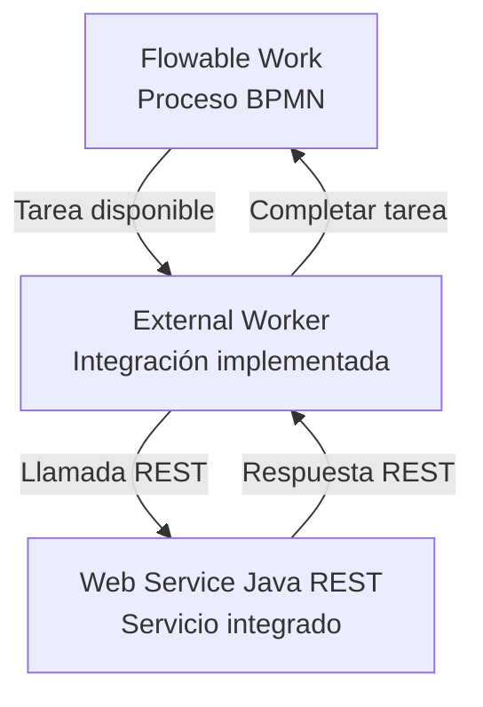

# Diagrama de arquitectura — Peluditos Pet Chile

## Estado de implementación

- Flowable Work: proceso conectado al External Worker.
- External Worker: integración con Flowable y Web Service implementada.
- Web Service Java REST: integrado con el External Worker.
- Integración completa: probada de extremo a extremo.

