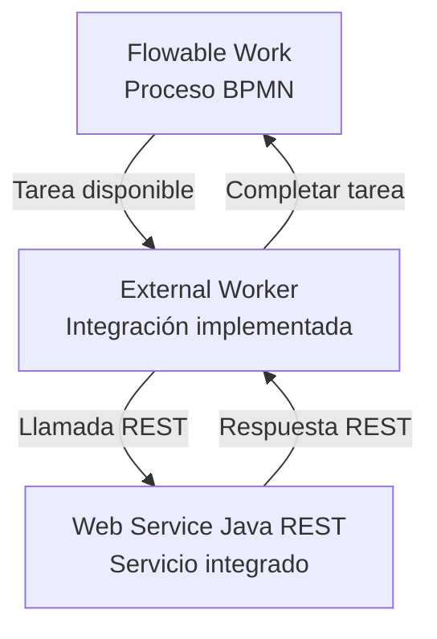

# Diagrama de arquitectura — Peluditos Pet Chile

## Estado de implementación

- **Web Service:** implementado y probado.
- **External Worker:** implementado. La conexión con Flowable se encuentra bloqueada por una falla del entorno Sandbox, según lo informado por el profesor.
- **Integración de extremo a extremo:** pendiente de validación.
- **Pruebas en Producción u OSS:** pendientes.

La integración completa aún no se declara como probada, ya que no se cuenta con evidencia que permita confirmar su funcionamiento de extremo a extremo. Esta validación queda pendiente hasta resolver el bloqueo de conexión y ejecutar las pruebas correspondientes.
