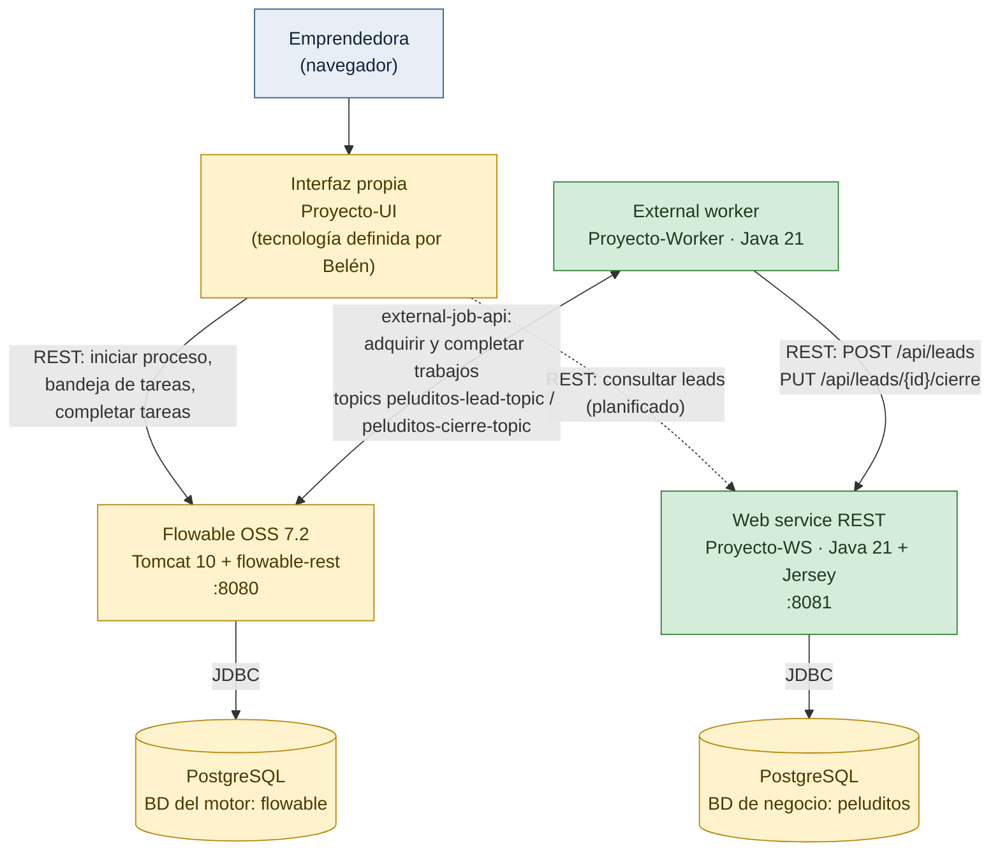

# Diagrama de arquitectura — Peluditos Pet Chile

> Versión: **Entrega 2** (Flowable OSS, interfaz propia y persistencia). Fuente editable: este bloque Mermaid. Imagen: [`modelo-arquitectura.png`](modelo-arquitectura.png).

**Leyenda:** verde = implementado · amarillo = en desarrollo (Entrega 2) · línea punteada = planificado.

## Componentes

| Componente | Responsabilidad | Tecnología | Estado |
|---|---|---|---|
| Interfaz propia | Registrar leads, bandeja de tareas, seguimiento y cierre | (definida por Belén) | En desarrollo |
| Flowable OSS | Ejecutar el proceso `peluditosLead` (TO-BE v2) y gestionar las tareas | Flowable 7.2 + Tomcat 10 | En desarrollo |
| BD del motor | Persistencia del motor de procesos | PostgreSQL (base `flowable`) | En desarrollo |
| External worker | Tomar los trabajos de las External Worker Tasks, llamar al web service y completar el trabajo | Java 21 | Implementado (Entrega 1); integración con Flowable OSS en desarrollo |
| Web service | Operaciones de negocio sobre leads (registro, consulta, seguimiento, cierre) | Java 21 + Jakarta REST (Jersey) | Implementado y probado en Entrega 1 (en memoria); conexión a BD en desarrollo |
| BD de negocio | Persistencia de leads, seguimientos y clientes | PostgreSQL (base `peluditos`) | En desarrollo |

## Comunicaciones principales

1. La **interfaz** inicia el proceso y completa las tareas de usuario mediante la API REST de Flowable (`/flowable-rest/service/...`).
2. El **worker** consulta a Flowable por trabajos (`/flowable-rest/external-job-api/...`), llama al **web service** y completa el trabajo con el resultado (`leadId`, `registrado`).
3. **Flowable** guarda su estado en la BD del motor; el **web service** guarda los datos de negocio en la BD de negocio.

Detalle de puertos, variables y contratos en [`ACUERDOS-INTEGRACION.md`](../ACUERDOS-INTEGRACION.md).

## Historial

| Entrega | Arquitectura |
|---|---|
| Entrega 1 | Flowable Cloud (Iplacex) + external worker + web service en memoria. La integración de punta a punta quedó pendiente por la falla del Sandbox y la caída de la plataforma (incidente de seguridad informado por el profesor). |
| Entrega 2 | Migración a Flowable OSS local con PostgreSQL, interfaz propia y base de datos de negocio. |
