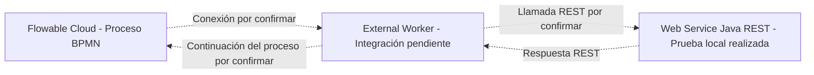

# Diagrama de arquitectura — Peluditos Pet Chile

## Estado de implementación

- Web Service Java REST: prueba local evidenciada por Christopher.
- External Worker: conexión e integración pendientes de confirmar.
- Integración completa del proceso: pendiente de prueba.

