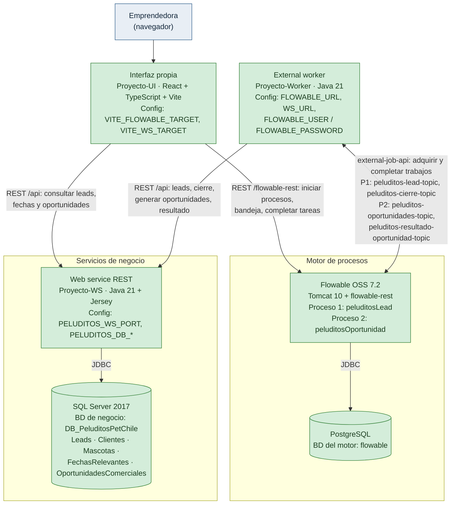
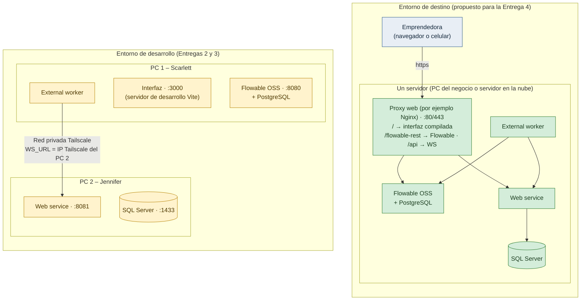

# Diagrama de arquitectura — Peluditos Pet Chile

> Versión: **Entrega 3**, con actualización documental para la **Entrega 4**. Se conservan los dos procesos de negocio, la configuración externa y el despliegue previsto.
> Fuente editable: los bloques Mermaid de este archivo. Imágenes: [`modelo-arquitectura.png`](modelo-arquitectura.png) (componentes) y [`modelo-despliegue.png`](modelo-despliegue.png) (entornos).

## 1. Componentes y comunicaciones

**Cómo leerlo:** la emprendedora solo usa la **interfaz**. Las tareas de personas (registrar, hacer seguimiento, contactar clientes, gestionar pedidos) se completan en la interfaz. Las tareas automáticas las hace el **worker**, que llama al **web service**. Cada componente lee sus direcciones, puertos y credenciales desde **variables de entorno**, no desde el código.

### Qué cambió respecto de la Entrega 2

| Cambio | Componentes afectados | Estado al 17-11 |
|---|---|---|
| Proceso 2 – Oportunidades comerciales (`peluditosOportunidad`) | BPMN, Flowable, worker (2 tópicos nuevos), WS (4 endpoints nuevos), interfaz | BPMN listo; resto en desarrollo |
| Proceso 1 v3: tarea "Registrar motivo de no compra" | BPMN, interfaz | BPMN listo; interfaz en desarrollo |
| Lead convertido → registrado como cliente (une los dos procesos) | WS | En desarrollo |
| Configuración externa (variables de entorno + `.env.example`) | Interfaz, WS (worker ya lo tenía) | En desarrollo |

> Esta tabla se actualiza después de la prueba de punta a punta del sábado 21-11.

## 2. Entornos: desarrollo y destino

| Parámetro | Desarrollo (hoy) | Destino (propuesto) |
|---|---|---|
| `FLOWABLE_URL` (worker) | `http://localhost:8080/flowable-rest` | `http://localhost:8080/flowable-rest` (mismo servidor) |
| `WS_URL` (worker) | `http://<IP Tailscale PC 2>:8081/api` | `http://localhost:8081/api` |
| `VITE_FLOWABLE_TARGET` / `VITE_WS_TARGET` (interfaz) | `http://localhost:8080` / `http://<IP Tailscale PC 2>:8081` | No aplica: las rutas las resuelve el proxy web |
| `PELUDITOS_DB_HOST` (WS) | `localhost` | `localhost` o la dirección del servidor de base de datos |
| Credenciales (`FLOWABLE_PASSWORD`, `PELUDITOS_DB_PASSWORD`) | Variables locales de cada integrante | Variables del servidor; nunca en el repositorio |

**Lo que cambia de un entorno a otro son solo valores de configuración, no el código.** Ese es el objetivo de la configuración externa de la Entrega 3.

**Riesgo identificado para la Entrega 4:** hoy la interfaz se ejecuta con el servidor de desarrollo de Vite, cuyo *proxy* solo existe en desarrollo. Para el entorno de destino hay que compilar la interfaz (`npm run build`) y servirla con un proxy web que redirija `/flowable-rest` y `/api`. Queda en el plan de la Entrega 4.

## 3. Componentes

| Componente | Responsabilidad | Tecnología | Responsable |
|---|---|---|---|
| Interfaz propia | Registrar leads, iniciar campañas, bandeja de tareas de ambos procesos, consultar estados | TypeScript + React + Vite | Eunices Belén Trujillo |
| Flowable OSS | Ejecutar `peluditosLead` y `peluditosOportunidad` y gestionar sus tareas | Flowable 7.2 + Tomcat 10 | Scarlett Paz Araya |
| BD del motor | Persistencia del motor de procesos | PostgreSQL (base `flowable`) | Scarlett Paz Araya |
| External worker | Atender los 4 tópicos: llamar al web service y completar el trabajo | Java 21 | Scarlett Paz Araya |
| Web service | Operaciones de negocio: leads, cierre, clientes, fechas relevantes y oportunidades | Java 21 + Jakarta REST (Jersey) + mssql-jdbc | Jennifer Igor España |
| BD de negocio | Leads, seguimientos, clientes, mascotas, fechas relevantes y oportunidades | Microsoft SQL Server 2017 (`DB_PeluditosPetChile`) | Jennifer Igor España |

**Quién es dueño de cada dato** (para evitar inconsistencias):
- **Flowable** guarda el estado de cada proceso y de sus tareas (qué falta por hacer).
- **SQL Server** guarda los datos del negocio (leads, clientes, oportunidades y sus resultados). Es la fuente oficial para consultar historiales.
- El vínculo entre ambos es el `process_instance_id`, que el worker envía al WS y que queda guardado en `Leads` y `OportunidadesComerciales`.

Detalle de variables, tópicos y contratos REST en [`ACUERDOS-INTEGRACION.md`](../ACUERDOS-INTEGRACION.md).

## Historial

| Entrega | Arquitectura |
|---|---|
| Entrega 1 | Flowable Cloud (Iplacex) + external worker + web service en memoria. La integración de punta a punta quedó pendiente por la falla del Sandbox y la caída de la plataforma (incidente de seguridad informado por el profesor). |
| Entrega 2 | Migración a Flowable OSS local con PostgreSQL (motor), interfaz propia y base de datos de negocio en SQL Server 2017. Prueba de punta a punta exitosa el 07-11-2026, con los dos caminos del proceso. Componentes repartidos en dos PCs unidos por Tailscale. |
| Entrega 3 | Segundo proceso (oportunidades comerciales), tarea de motivo de no compra, configuración externa por variables de entorno y diagrama de despliegue (desarrollo vs. destino). |

---

## Actualización de arquitectura – Entrega 4

Esta sección complementa la arquitectura documentada en las entregas anteriores. Se conserva la estructura original y se incorporan las verificaciones y decisiones correspondientes a la integración de plataformas.

### 4.1. Puertos del entorno de desarrollo

Se registran los siguientes valores confirmados para el entorno de desarrollo de Jennifer:

| Componente | Puerto | Observación |
|---|---:|---|
| Web Service Java | `8081` | Puerto utilizado por el servicio REST |
| SQL Server | `1435` | Puerto utilizado actualmente por SQL Server en el entorno local |

**Aclaración sobre el diagrama original:** el puerto `1433` que aparece en el dibujo de desarrollo corresponde a la configuración anterior/documentada. Para las pruebas actuales de Jennifer se confirma el puerto `1435`. Se conserva el dato original para mantener el historial de arquitectura.

Estos puertos son valores del entorno de desarrollo y no deben asumirse como los definitivos del despliegue remoto.

### 4.2. Integración y responsabilidades de los componentes

En la Entrega 4 se mantiene la arquitectura distribuida en componentes con responsabilidades diferenciadas:

- La interfaz propia permite iniciar procesos y realizar las tareas de usuario.
- Flowable OSS administra las instancias de los procesos BPMN y sus tareas.
- El External Worker atiende los tópicos configurados, ejecuta las operaciones solicitadas y comunica el resultado a Flowable.
- El Web Service Java ofrece las operaciones REST relacionadas con los datos del negocio.
- PostgreSQL mantiene la persistencia interna del motor Flowable.
- SQL Server mantiene la información de negocio de Peluditos Pet Chile.

### 4.3. Persistencia y recuperación

La solución utiliza dos bases de datos relacionales con finalidades distintas:

- PostgreSQL para la información interna de Flowable.
- SQL Server para la información comercial almacenada por el Web Service.

La comprobación de persistencia después del reinicio de los componentes debe registrarse mediante pruebas y evidencias de la Entrega 4. No se debe dar por verificada hasta contar con resultados que demuestren que la información permanece disponible después del reinicio.

### 4.4. Preparación del despliegue remoto

El equipo contempla Azure como entorno de destino. El diagrama de despliegue existente representa una propuesta de arquitectura y no debe interpretarse como una instalación final confirmada.

Los datos definitivos que deben documentarse cuando el equipo complete el despliegue son:

| Elemento | Dato que debe confirmarse |
|---|---|
| Servidor | Dirección IP o nombre DNS |
| Flowable OSS | Dirección y puerto de acceso |
| PostgreSQL | Dirección, puerto y base de datos |
| Web Service Java | Dirección y puerto de acceso |
| SQL Server | Dirección, puerto y base de datos |
| External Worker | Direcciones de Flowable y del Web Service |
| Interfaz propia | Dirección de acceso y configuración del proxy |
| Seguridad | Configuración de credenciales y variables secretas |

Las contraseñas, tokens y archivos `.env` reales deben mantenerse fuera del repositorio.

### 4.5. Verificaciones de integración para EV4

Las pruebas de integración deben respaldar los siguientes puntos:

- Comunicación entre Flowable y el External Worker.
- Comunicación entre el External Worker y el Web Service Java.
- Comunicación entre el Web Service y SQL Server.
- Ejecución de los procesos BPMN desde la interfaz propia.
- Persistencia de los registros de negocio.
- Recuperación de la información después de reiniciar los componentes.
- Disponibilidad de los servicios mediante sus mecanismos de comprobación.

Los resultados deben quedar respaldados por capturas o registros de pruebas. Las funcionalidades que aún no hayan sido verificadas deben identificarse como pendientes.

### 4.6. Documentos relacionados

Esta documentación se complementa con:

- `Arquitectura/README.md`: índice y decisiones de arquitectura.
- `ACUERDOS-INTEGRACION.md`: acuerdos técnicos, variables, tópicos y contratos REST.
- `Docs/Manual-Tecnico.md`: instrucciones de instalación y configuración.
- `BPMN/`: modelos de procesos editables e imágenes.
- `Pruebas/`: resultados y evidencias de integración.
- `Videos/Entrega-4/`: videos solicitados para la entrega.

La documentación y los diagramas deben mantenerse actualizados de acuerdo con la configuración y el funcionamiento real de la solución.
