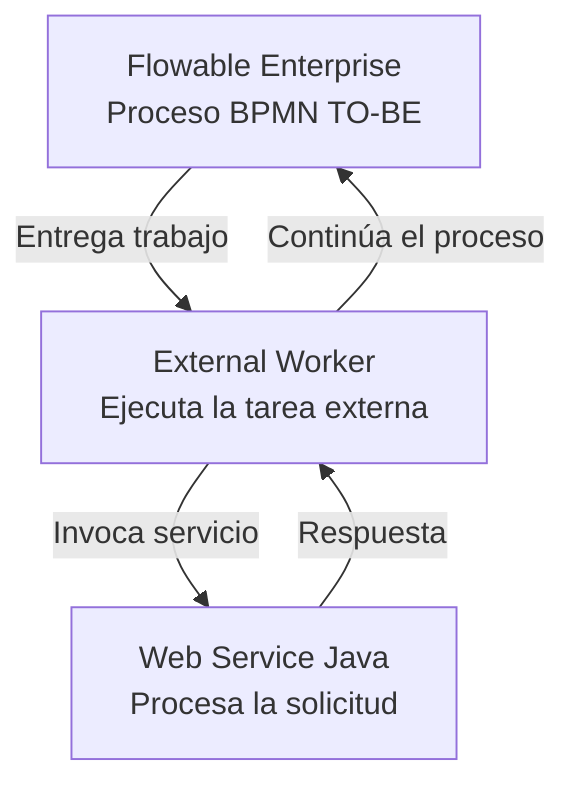

# Diagrama de arquitectura — Peluditos Pet Chile

## Estado de los componentes

- **Flowable Enterprise:** [ En desarrollo]
- **External Worker:** [Planificado]
- **Web Service Java:** [planificado]
