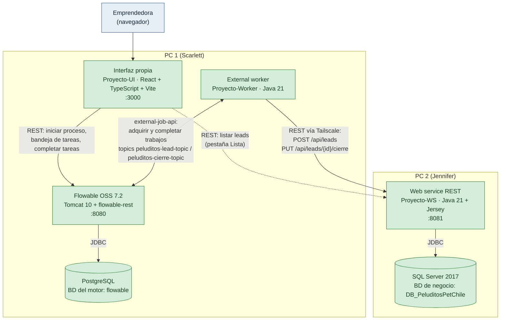

# Diagrama de arquitectura — Peluditos Pet Chile

> Versión: **Entrega 2** (Flowable OSS, interfaz propia y persistencia). Fuente editable: este bloque Mermaid. Imagen: [`modelo-arquitectura.png`](modelo-arquitectura.png).

**Leyenda:** verde = implementado y probado de punta a punta (07-11-2026) · línea punteada = implementado en la interfaz (pestaña "Lista"), pero no incluido en la prueba E2E.

En la prueba E2E los componentes corrieron en **dos computadores** unidos por la red privada **Tailscale**: Flowable, PostgreSQL, el worker y la interfaz en uno, y el web service con SQL Server en otro. Evidencia en [`Pruebas/Entrega-2/E2E/`](../Pruebas/Entrega-2/E2E/).

## Componentes

| Componente | Responsabilidad | Tecnología | Estado |
|---|---|---|---|
| Interfaz propia | Registrar leads, bandeja de tareas, seguimiento y cierre | TypeScript + React + Vite (proxy hacia Flowable y el WS) | Implementado y probado E2E |
| Flowable OSS | Ejecutar el proceso `peluditosLead` (TO-BE v2) y gestionar las tareas | Flowable 7.2 + Tomcat 10 | Implementado: TO-BE v2 desplegado y ejecutado |
| BD del motor | Persistencia del motor de procesos | PostgreSQL (base `flowable`) | Implementado |
| External worker | Tomar los trabajos de las External Worker Tasks, llamar al web service y completar el trabajo | Java 21 | Implementado: atiende los dos topics (registro y cierre) |
| Web service | Operaciones de negocio sobre leads (registro, consulta, seguimiento, cierre) | Java 21 + Jakarta REST (Jersey) + mssql-jdbc | Implementado y conectado a SQL Server |
| BD de negocio | Persistencia de leads, seguimientos y clientes (6 tablas) | Microsoft SQL Server 2017 (base `DB_PeluditosPetChile`) | Implementado: los leads quedan como Nuevo / Convertido / No convertido |

## Comunicaciones principales

1. La **interfaz** inicia el proceso y completa las tareas de usuario mediante la API REST de Flowable (`/flowable-rest/service/...`). Las llamadas pasan por el proxy de Vite, por lo que no se requiere CORS.
2. El **worker** consulta a Flowable por trabajos (`/flowable-rest/external-job-api/...`), llama al **web service** y completa el trabajo con el resultado (`leadId`, `registrado`). En el cierre llama a `PUT /api/leads/{id}/cierre` con `compro` y `motivoNoCompra`.
3. **Flowable** guarda su estado en la BD del motor; el **web service** guarda los datos de negocio en la BD de negocio.

Detalle de puertos, variables y contratos en [`ACUERDOS-INTEGRACION.md`](../ACUERDOS-INTEGRACION.md).

## Historial

| Entrega | Arquitectura |
|---|---|
| Entrega 1 | Flowable Cloud (Iplacex) + external worker + web service en memoria. La integración de punta a punta quedó pendiente por la falla del Sandbox y la caída de la plataforma (incidente de seguridad informado por el profesor). |
| Entrega 2 | Migración a Flowable OSS local con PostgreSQL (motor), interfaz propia y base de datos de negocio en SQL Server 2017. Prueba de punta a punta exitosa el 07-11-2026, con los dos caminos del proceso. |
