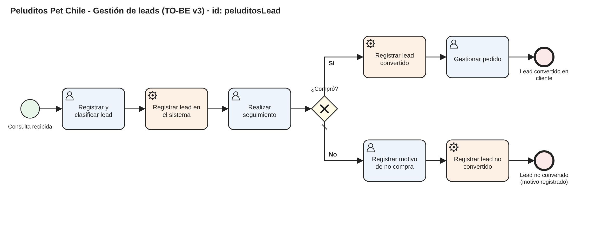
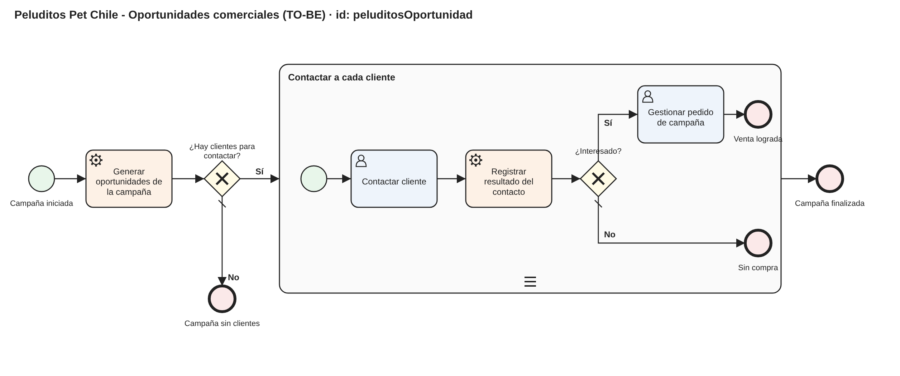

# Modelos BPMN

| Archivo | Imagen | Descripción |
|---|---|---|
| `AS-IS.bpmn` | `AS-IS.svg` | Proceso actual: atención de consultas (Problema 1) y recontacto en fechas especiales (Problema 2) |
| `TO-BE.bpmn` | `TO-BE.png` / `TO-BE.svg` | **Proceso 1 – Gestión de leads (v3)**, ejecutable en Flowable OSS (clave `peluditosLead`) |
| `TO-BE-oportunidades.bpmn` | `TO-BE-oportunidades.png` / `.svg` | **Proceso 2 – Oportunidades comerciales**, ejecutable en Flowable OSS (clave `peluditosOportunidad`) |
| `gestion-lead-minimo.bpmn20.xml` | `gestion-lead-minimo.png` | Proceso mínimo de prueba de la Entrega 1 (histórico, ya no se usa) |

> En la Entrega 1 el TO-BE se modeló en Flowable Design (Enterprise). Para la Entrega 2 se adaptó a **Flowable OSS**: se quitaron los formularios de Enterprise (ahora las tareas se completan desde la interfaz propia) y las tareas de servicio son External Worker Tasks.

## AS-IS – Descripción

El archivo `AS-IS.bpmn` contiene los dos procesos actuales, separados visualmente mediante **grupos** dentro del pool *Peluditos Pet Chile*.

**Participantes:**
- Pool *Cliente* (expandido): participa en el Proceso 1.
- Pool *Peluditos Pet Chile*, con el lane *Emprendedora*: realiza ambos procesos.
- Pool *Clientes y seguidores* (colapsado, caja negra): recibe las promociones del Proceso 2.

### Proceso 1: Atención de consultas
- **Flujo:** el cliente consulta por mensaje directo, teléfono o tienda web → la emprendedora lee la consulta y responde con precios, opciones y disponibilidad → si el cliente confirma y transfiere, se verifica el pago, se prepara el pedido y se entrega; si el cliente deja de responder, la consulta queda sin seguimiento.
- **Elementos BPMN:** eventos de inicio y fin, eventos de mensaje (inicio e intermedio), evento de temporizador, gateway exclusivo, gateway basado en eventos, flujos de mensaje, almacén de datos y anotaciones.
- **Dolores:** no se registra la consulta ni el canal; no hay recontacto; no se registra al cliente ni a su mascota; el perfil no tiene enlace directo a WhatsApp.

### Proceso 2: Recontacto en fechas especiales
- **Flujo:** la emprendedora recuerda una fecha → busca clientes en los chats → publica una promoción o envía mensajes uno a uno → responde las consultas que lleguen.
- **Elementos BPMN:** gateway exclusivo de división y unión, almacén de datos, pool colapsado, flujos de mensaje y anotaciones.
- **Dolores:** depende de la memoria; no hay registro de fechas ni de cumpleaños de mascotas; no se mide el resultado de las campañas; publicaciones esporádicas y sin calendario de campañas.
- **Evidencia (Instagram, 17-10-2026):** se celebran cumpleaños de mascotas, pero no hay campaña de Halloween.

### Criterio de modelado
Las tareas se modelaron de forma **genérica** (por ejemplo, "Preparar pedido"), para que el proceso aplique a cualquier producto del emprendimiento, según la indicación del profesor.

## Supuestos (por validar con la emprendedora)
- El AS-IS se basó en el documento del caso, la tienda web y el Instagram; aún no hay respuestas de la emprendedora.
- Las ventas se cierran por mensajería con pago por transferencia (único medio visible en la tienda).
- No existe hoy ningún registro de consultas, clientes ni mascotas.
- Las campañas se difunden por publicaciones en redes o mensajes uno a uno por WhatsApp.

## Proceso 1 – Gestión de leads (TO-BE v3)

**Flujo:** Consulta recibida → **Registrar y clasificar lead** (interfaz) → **Registrar lead en el sistema** (worker → `POST /api/leads`) → **Realizar seguimiento** (interfaz) → **¿Compró?**
- **Sí:** **Registrar lead convertido** (worker → `PUT /api/leads/{id}/cierre`) → **Gestionar pedido** (interfaz) → *Lead convertido en cliente*.
- **No:** **Registrar motivo de no compra** (interfaz) → **Registrar lead no convertido** (worker → `PUT /api/leads/{id}/cierre`) → *Lead no convertido (motivo registrado)*.

| Actividad (id) | Tipo | Ejecuta |
|---|---|---|
| `registrarLead` | User task | Interfaz propia |
| `procesarWS` | External worker task – topic `peluditos-lead-topic` | Proyecto-Worker → Proyecto-WS |
| `realizarSeguimiento` | User task | Interfaz propia |
| `gwCompro` | Exclusive gateway (`${compro == true}`; por defecto: No) | Motor |
| `cerrarConvertido` / `cerrarNoConvertido` | External worker task – topic `peluditos-cierre-topic` | Proyecto-Worker → Proyecto-WS |
| `gestionarPedido` | User task | Interfaz propia |
| `registrarMotivo` | User task | Interfaz propia |

**Cambio de la v3 (Entrega 3):** a partir de la retroalimentación de la Entrega 2, el motivo de no compra se registra en una **tarea propia** (`registrarMotivo`) antes de cerrar el lead, con un motivo de una lista y un comentario libre. Así el proceso conserva la información de por qué se pierden las ventas. Por eso el cierre ahora ocurre después del gateway, en las dos ramas, con el mismo tópico del worker.

**Cómo resuelve los dolores del AS-IS (Proceso 1):**

| Dolor del AS-IS | Mejora en el TO-BE |
|---|---|
| No se registra la consulta ni el canal | `registrarLead` + `procesarWS` guardan el lead con su canal en la base de datos |
| Si el cliente no responde, no hay recontacto | `realizarSeguimiento` queda como tarea pendiente en la bandeja hasta que se resuelve |
| No se sabe por qué no compró ni cuántos compran | `registrarMotivo` y el cierre del lead registran `compro`, `motivoNoCompra` y un comentario, lo que permite medir la conversión |
| No se registra al cliente | El lead convertido se registra como cliente y puede recibir campañas (Proceso 2) |

**Cambios respecto de la Entrega 1:**
- Se reemplazó la tarea simulada (Service Task tipo *Expression*) por **External Worker Tasks reales**.
- Se eliminaron los formularios de Flowable Enterprise; la interfaz propia completa las tareas.
- Se agregaron el seguimiento con resultado y el cierre del lead.
- Las ramas por producto (repostería, baños, repuestos) se reemplazaron por una tarea genérica **"Gestionar pedido"**, según la indicación del profesor de modelar de forma genérica. El tipo de producto se conserva en la variable `servicioRequerido`.

## Proceso 2 – Oportunidades comerciales (TO-BE)

**Flujo:** la emprendedora inicia una **campaña** eligiendo una fecha relevante (por ejemplo, Navidad) → **Generar oportunidades de la campaña** (worker → `POST /api/oportunidades/generar`: una oportunidad por cada cliente que acepta comunicaciones) → **¿Hay clientes para contactar?**
- **No:** *Campaña sin clientes*.
- **Sí:** subproceso **Contactar a cada cliente**, que se repite una vez por oportunidad (multi-instancia secuencial): **Contactar cliente** (interfaz) → **Registrar resultado del contacto** (worker → `PUT /api/oportunidades/{id}/resultado`) → **¿Interesado?** → Sí: **Gestionar pedido de campaña** · No: *Sin compra*. Al terminar con todos los clientes → *Campaña finalizada*.

| Actividad (id) | Tipo | Ejecuta |
|---|---|---|
| `generarOportunidades` | External worker task – topic `peluditos-oportunidades-topic` | Proyecto-Worker → Proyecto-WS |
| `gwHayClientes` | Exclusive gateway (`${totalOportunidades > 0}`) | Motor |
| `contactarClientes` | Subproceso multi-instancia secuencial sobre `${oportunidades}` | Motor |
| `contactarCliente` | User task | Interfaz propia |
| `registrarResultado` | External worker task – topic `peluditos-resultado-oportunidad-topic` | Proyecto-Worker → Proyecto-WS |
| `gwInteresado` | Exclusive gateway (`${interesado == true}`; por defecto: No) | Motor |
| `gestionarPedidoCampana` | User task | Interfaz propia |

**Cómo resuelve los dolores del AS-IS (Proceso 2):**

| Dolor del AS-IS | Mejora en el TO-BE |
|---|---|
| El recontacto depende de la memoria de la emprendedora | Las fechas quedan registradas en `FechasRelevantes` y la campaña se inicia desde la interfaz |
| Hay que buscar a los clientes en los chats | El sistema genera la lista de clientes a contactar (`generarOportunidades`) |
| No se mide el resultado de las campañas | Cada contacto queda registrado como `Ganada` o `Sin compra`, con comentario |
| Se contacta a personas sin saber si aceptan mensajes | Solo se generan oportunidades para clientes con `acepta_comunicaciones = 1` |

Los leads convertidos del Proceso 1 se registran como clientes, así que **el Proceso 1 alimenta al Proceso 2**.

## Variables del Proceso 1 (TO-BE)

| Variable | Tipo | Origen | Uso |
|---|---|---|---|
| `nombre`, `telefono`, `correo`, `canal`, `interes` | string | Interfaz (registro) | Worker → WS |
| `servicioRequerido` | string (`reposteria`, `banos`, `repuestos`) | Interfaz (clasificación) | Gestionar pedido |
| `leadId` | integer | Worker (respuesta del WS) | Cierre del lead |
| `registrado` | boolean | Worker | Control |
| `compro` | boolean | Interfaz (seguimiento) | Gateway ¿Compró? y cierre |
| `motivoNoCompra`, `comentarioNoCompra` | string | Interfaz (registrar motivo) | Cierre del lead |

Variables del Proceso 2 y detalle completo en [`ACUERDOS-INTEGRACION.md`](../ACUERDOS-INTEGRACION.md).

## Historial de versiones

| Fecha | Versión | Cambio | Autor |
|---|---|---|---|
| 2026-10-17 | v1.0 | AS-IS atención de consultas y recontacto de clientes (dos archivos) | Christopher Comas Celis |
| 2026-10-20 | v1.1 | Unificación en `AS-IS.bpmn` según documento de la Entrega 1; tareas genéricas; evidencia del Instagram | Christopher Comas Celis |
| 2026-11-02 | TO-BE v2 | TO-BE adaptado a Flowable OSS (External Worker Tasks, seguimiento y cierre, tareas genéricas) | Christopher Comas Celis |
| 2026-11-17 | TO-BE v3 + Proceso 2 | Tarea "Registrar motivo de no compra" en el Proceso 1; nuevo TO-BE de oportunidades comerciales; imágenes PNG de todos los modelos | Christopher Comas Celis |
