# Evidencias – Prueba de punta a punta (E2E)

**Responsable:** Christopher Comas Celis
**Fecha de la prueba:** 07-11-2026, reunión por Google Meet (09:40 – 10:10)
**Participantes:** Scarlett Paz, Jennifer Igor, Eunices Belén Trujillo y Christopher Comas

Recorrido completo: **interfaz propia → Flowable OSS 7.2 → external worker → web service → SQL Server**, según la sección 6 de `ACUERDOS-INTEGRACION.md`. Se probaron los dos caminos del gateway `gwCompro`.

## Cómo estaba montado

Los componentes corrieron en **dos computadores**, conectados por la red privada Tailscale:

| PC | Componentes |
|---|---|
| Scarlett | Flowable OSS 7.2 (Tomcat, `:8080`) con PostgreSQL, worker `PeluditosApp` y la interfaz React (`:3000`) |
| Jennifer | Web service Java (`:8081`) y SQL Server 2017 (`DB_PeluditosPetChile`) |

## Recorrido B – el cliente sí compra (lead 8)

| # | Captura | Qué demuestra |
|---|---|---|
| 01 | 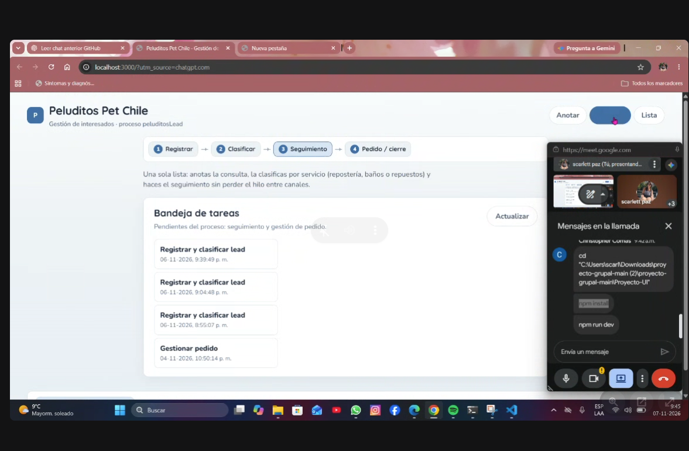 | La interfaz lee las tareas pendientes del proceso `peluditosLead` desde Flowable. |
| 02 | 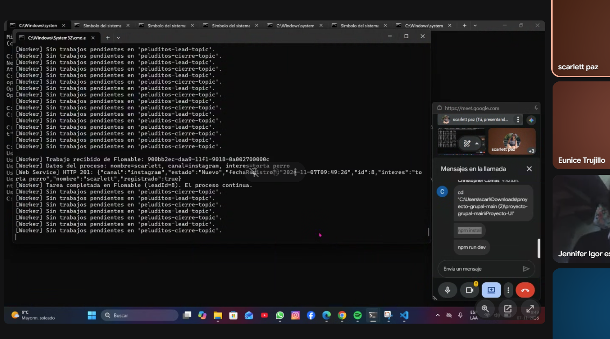 | Tras registrar el lead desde la interfaz ("Anotar"), el worker toma el trabajo de `peluditos-lead-topic`, llama a `POST /api/leads` y recibe **HTTP 201** con `leadId = 8`. |
| 03 | 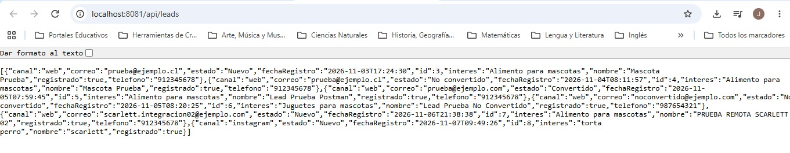 | `GET /api/leads` en el PC de Jennifer: el lead 8 existe con estado **Nuevo**. |
| 04 | 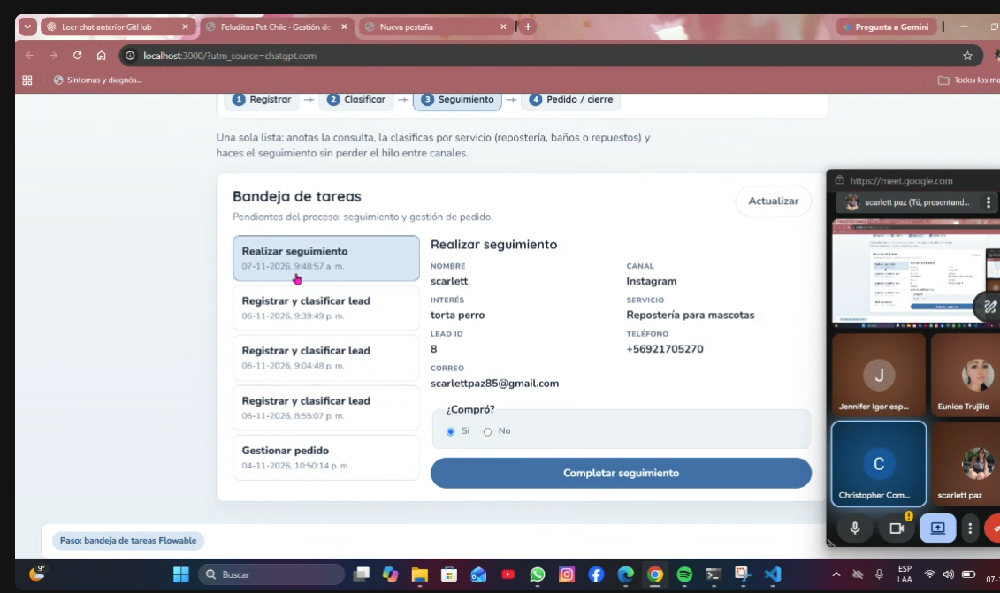 | La bandeja muestra "Realizar seguimiento" con los datos del proceso. Se completa con **¿Compró? = Sí**. |
| 05 | 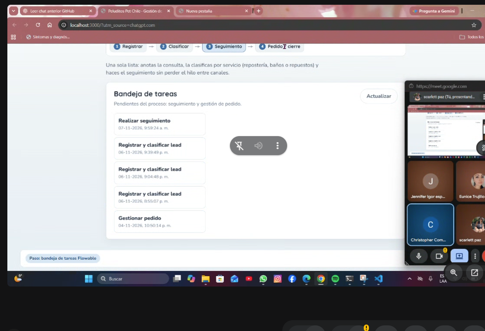 | La tarea de seguimiento del lead 8 desaparece (y aparece la del lead 9, registrado para el recorrido A). |
| 06 | 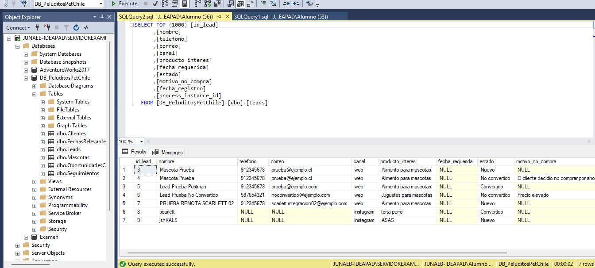 | Tabla `dbo.Leads` en SQL Server: el worker cerró el lead 8 vía `PUT /api/leads/8/cierre` → **Convertido**. |
| 07 | 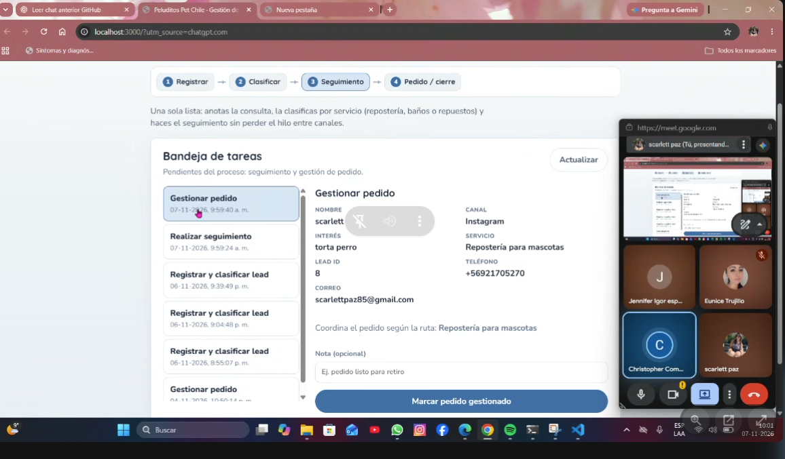 | Como compró, el gateway lleva a **"Gestionar pedido"** (Repostería para mascotas). |
| 08 | 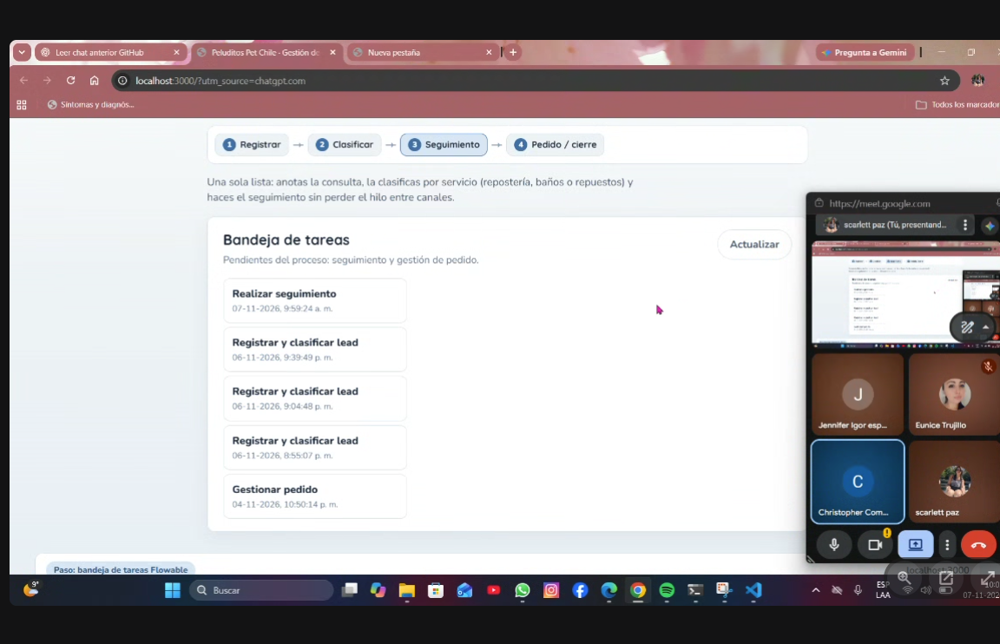 | Al marcar el pedido como gestionado, la tarea desaparece: **la instancia terminó**. |

## Recorrido A – el cliente no compra (lead 9)

| # | Captura | Qué demuestra |
|---|---|---|
| 09 | 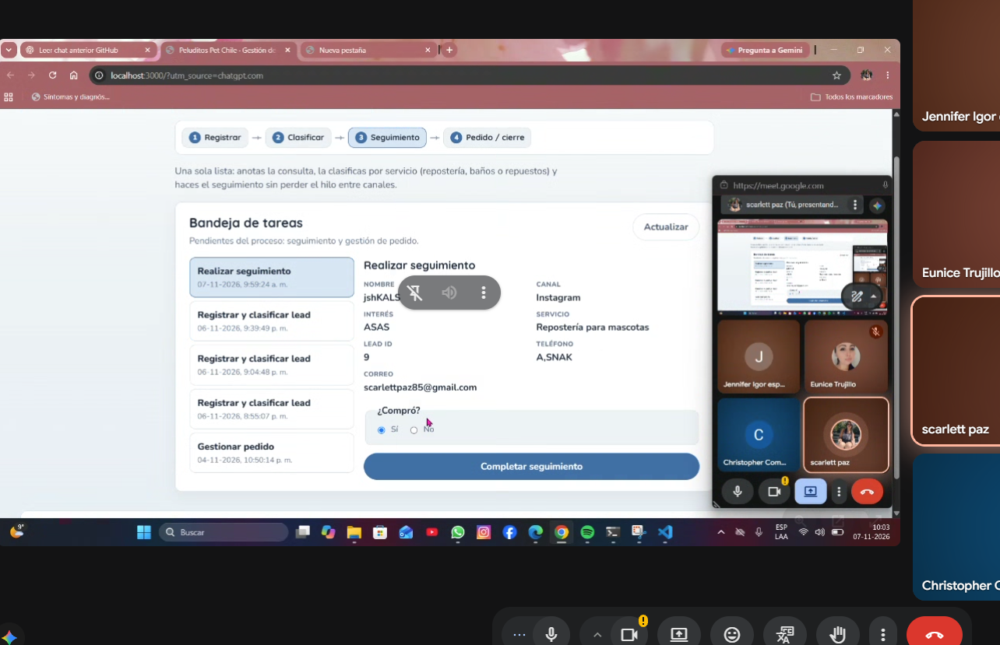 | "Realizar seguimiento" del lead 9. En la captura aún está marcado "Sí" (valor por defecto); se cambió a **No** antes de completar, con el motivo "no quiero". |
| 10 | 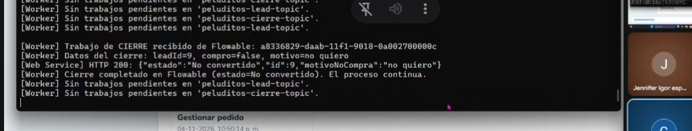 | El worker toma `peluditos-cierre-topic` con `compro=false`; el WS responde **HTTP 200 → No convertido**. |
| 11 | 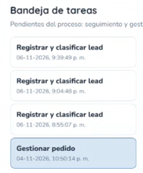 | No aparece un "Gestionar pedido" nuevo: el proceso terminó por la rama "no compró". (Las tareas que quedan son de pruebas anteriores, del 04-11 y 06-11.) |
| 12 | 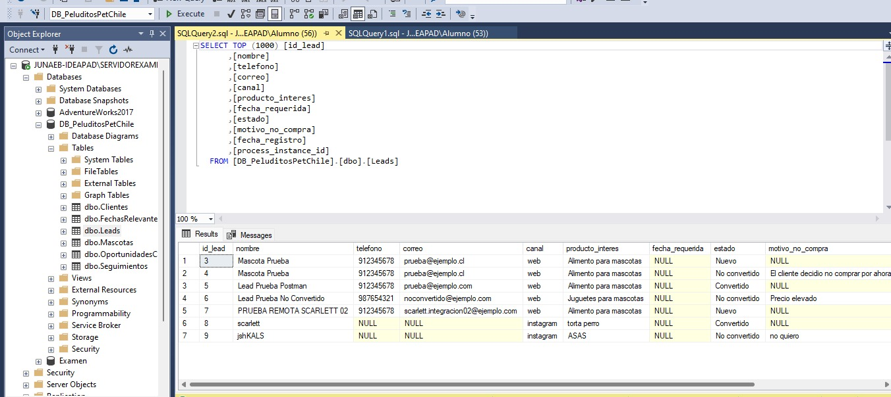 | SQL Server: lead 9 **No convertido** con `motivo_no_compra = "no quiero"`, junto al lead 8 Convertido. |

## Resultado

- ✅ Los dos caminos del proceso funcionan de punta a punta desde la interfaz propia (sin Flowable Forms).
- ✅ Los datos quedan persistidos en la base de negocio. Los leads 3 a 7, creados en pruebas de días anteriores, siguen en la tabla.
- ✅ Integración entre dos computadores (Flowable y worker en un PC, WS y BD en otro).

## Observaciones y mejoras pendientes

- El worker solo envía `nombre`, `canal` e `interes` al WS; por eso `telefono`, `correo` y `process_instance_id` quedan en `NULL` para los leads 8 y 9, aunque sí están en las variables del proceso (se ven en la bandeja). Ajuste propuesto en `PeluditosApp.java`.
- La opción "¿Compró?" viene marcada en "Sí" por defecto; conviene que no tenga valor inicial, para evitar cierres por error.
- Los nombres de prueba ("scarlett", "jshKALS") se usaron solo para esta prueba técnica.
