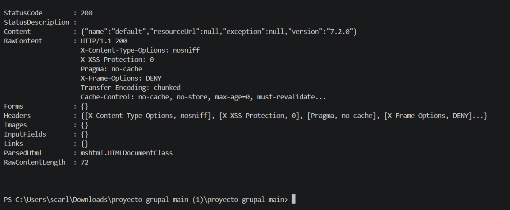
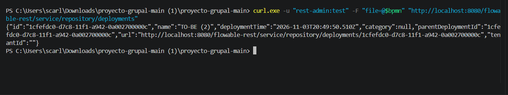
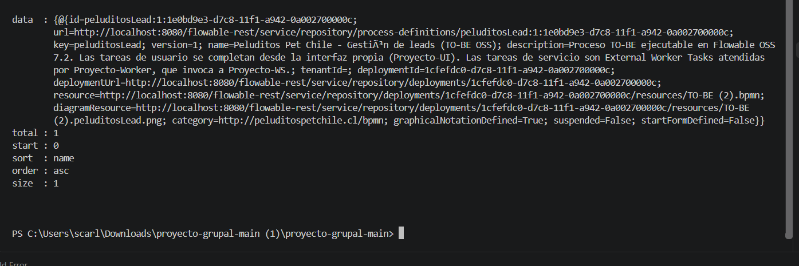
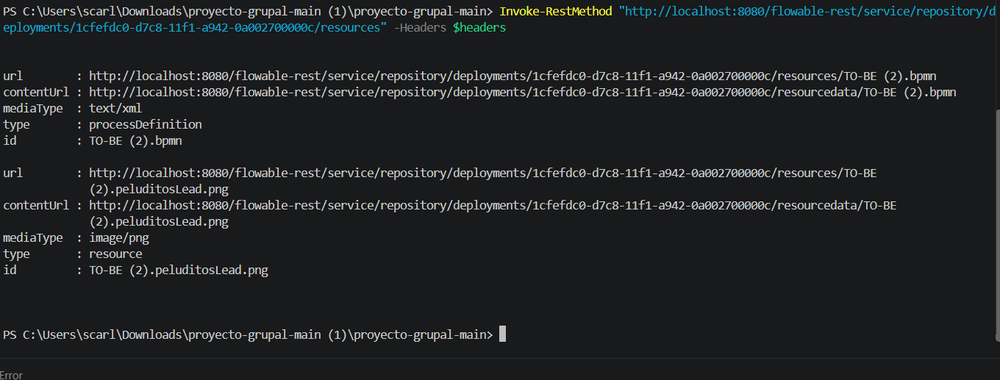
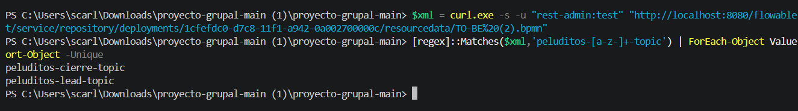
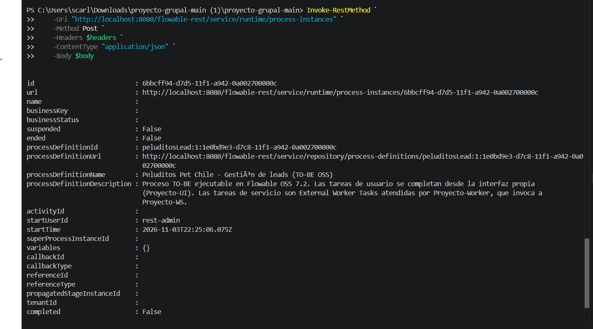
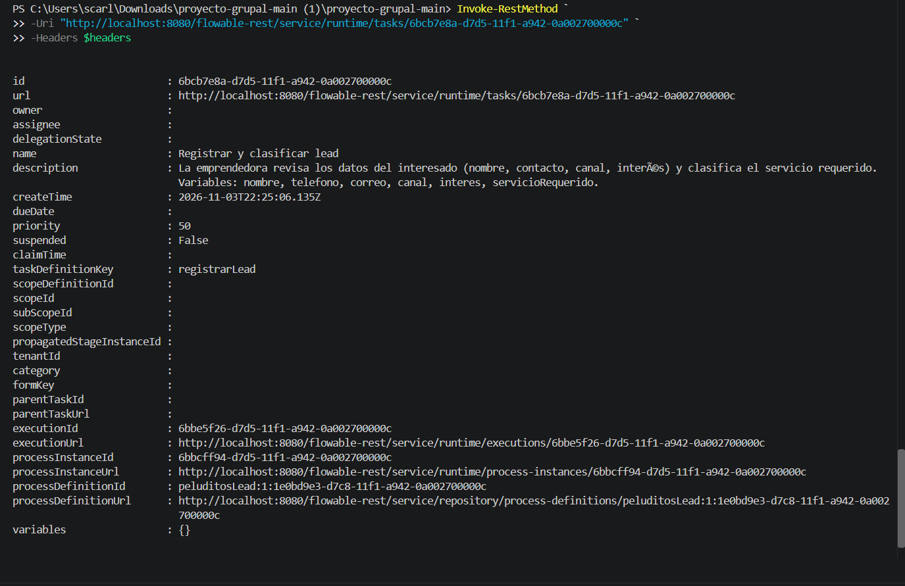

# Evidencias – Flowable OSS

**Responsable:** Scarlett Paz Araya

Este apartado contiene las evidencias de instalación, despliegue y pruebas iniciales del proceso TO-BE de Peluditos Pet Chile utilizando Flowable OSS 7.2.

## 1. Instalación y verificación de Flowable OSS

### 01. Verificación de Flowable OSS 7.2

Se verifica el funcionamiento del servicio REST de Flowable OSS mediante una respuesta HTTP 200 (OK), confirmando que el motor se encuentra operativo en su versión 7.2.0.

## 2. Despliegue del proceso TO-BE

### 02. Despliegue del proceso TO-BE

Se evidencia el despliegue del archivo `TO-BE (2).bpmn` en el motor Flowable OSS mediante el servicio REST. La respuesta confirma la creación del despliegue.

### 03. Definición del proceso

Se comprueba que Flowable reconoce correctamente el proceso `peluditosLead`, denominado Peluditos Pet Chile - Gestión de leads (TO-BE OSS), correspondiente a la versión 1.

### 04. Recursos del despliegue

Se verifica que el despliegue contiene el archivo BPMN del proceso y su recurso gráfico asociado.

### 05. Tópicos del Worker

Se comprueba que el nuevo modelo BPMN contiene los dos tópicos de servicio externo que deberá atender el Worker:

- `peluditos-lead-topic`
- `peluditos-cierre-topic`

## 3. Ejecución inicial del nuevo proceso

### 06. Inicio de instancia TO-BE

Se inicia correctamente una instancia del proceso `peluditosLead` en Flowable OSS. La respuesta confirma que la instancia se encuentra activa y no suspendida.

### 07. Creación de la tarea Registrar y clasificar lead

Se consulta la instancia del proceso y se comprueba la creación de la primera tarea humana, correspondiente al registro y clasificación del interesado.

### 08. Detalle de la tarea

Se consulta el detalle de la tarea humana, verificando su identificador, descripción y asociación con la instancia del nuevo proceso. Se observa que la tarea no tiene un formulario de Flowable asociado, ya que su gestión corresponde a la interfaz propia del proyecto.

## 4. Estado actual y actividades pendientes

Se ha comprobado la instalación y disponibilidad de Flowable OSS 7.2, el despliegue del nuevo proceso TO-BE, la identificación de sus dos tópicos y la creación de una instancia con su primera tarea humana.

**Pendiente de validación:**

- Configuración y comprobación de PostgreSQL.
- Actualización e integración del Worker con ambos tópicos.
- Comunicación del Worker con el Web Service.
- Registro y cierre de leads.
- Ejecución completa del proceso.
- Validación de las dos rutas: lead convertido y no convertido.

Las pruebas de integración y ejecución completa se realizarán una vez que se encuentre disponible la versión actualizada del Worker y del Web Service.
