# Peluditos Pet Chile — Integración Flowable, Worker y Web Service

Responsable: Scarlett Paz

**Entrega 2 · Evidencias técnicas**

## 1. Descripción

Este trabajo implementa el proceso de gestión de leads de **Peluditos Pet Chile**, emprendimiento dedicado a productos de pastelería para mascotas. La solución permite registrar interesados que llegan por distintos canales, realizar su seguimiento y actualizar el resultado comercial.

La automatización utiliza **Flowable OSS 7.2.0** para ejecutar el proceso BPMN, un **External Worker Java** para atender tareas de servicio y un **Web Service REST** para realizar operaciones sobre la base de datos de negocio en **Microsoft SQL Server**.

Además, Flowable utiliza **PostgreSQL** como base de datos interna para persistir su motor, definiciones, ejecuciones e historial. PostgreSQL y SQL Server cumplen funciones distintas dentro de la solución.

## 2. Arquitectura de la solución

```text
                 ┌──────────────────────────┐
                 │       Flowable OSS       │
                 │          7.2.0           │
                 │ Persistencia: PostgreSQL │
                 └────────────┬─────────────┘
                              │ External Worker Jobs
                 ┌────────────▼─────────────┐
                 │   Proyecto-Worker        │
                 │   PeluditosApp.java      │
                 └────────────┬─────────────┘
                              │ HTTP REST
                 ┌────────────▼─────────────┐
                 │      Proyecto-WS        │
                 │      Web Service        │
                 └────────────┬─────────────┘
                              │ JDBC
                 ┌────────────▼─────────────┐
                 │       SQL Server        │
                 │   DB_PeluditosPetChile  │
                 │ Datos de negocio        │
                 └─────────────────────────┘
```

### Responsabilidad de cada componente

| Componente | Responsabilidad |
|---|---|
| Flowable OSS 7.2.0 | Ejecuta el BPMN y administra las tareas humanas y de servicio. Su persistencia se configuró en PostgreSQL. |
| PostgreSQL (`flowable_db`) | Almacena las tablas internas del motor Flowable. |
| Proyecto-Worker (`PeluditosApp.java`) | Consulta los topics de Flowable, ejecuta las operaciones solicitadas y confirma la finalización de los trabajos. |
| Proyecto-WS | Expone los endpoints REST que utiliza el Worker. |
| SQL Server (`DB_PeluditosPetChile`) | Almacena los datos del negocio: leads, clientes, mascotas, seguimientos, fechas relevantes y oportunidades comerciales. |

## 3. Topics atendidos por el Worker

| Topic | Operación REST | Resultado esperado |
|---|---|---|
| `peluditos-lead-topic` | `POST /api/leads` | Registra un nuevo lead y devuelve su identificador. |
| `peluditos-cierre-topic` | `PUT /api/leads/{id}/cierre` | Actualiza el resultado del seguimiento del lead, por ejemplo a `Convertido`. |

El proceso BPMN utiliza la clave `peluditosLead` e incluye las tareas humanas **Registrar y clasificar lead** y **Realizar seguimiento**, junto con las tareas de servicio atendidas por el Worker.

## 4. Bases de datos

### SQL Server — datos de negocio

- Base de datos: `DB_PeluditosPetChile`.
- Puerto configurado: `1433`.
- Tablas verificadas: `Clientes`, `FechasRelevantes`, `Leads`, `Mascotas`, `OportunidadesComerciales` y `Seguimientos`.
- El Web Service utiliza el usuario de aplicación `peluditos_java`.

### PostgreSQL — persistencia de Flowable

- Base de datos: `flowable_db`.
- Puerto predeterminado: `5432`.
- Esquema: `public`.
- Se verificó la creación de 62 tablas internas de Flowable (`act_...`).
- Se instaló el controlador PostgreSQL JDBC 42.7.14 en Tomcat.
- La definición BPMN `peluditosLead`, versión 1, se desplegó nuevamente en esta base.

> **Importante:** PostgreSQL almacena la información interna de Flowable. SQL Server conserva la información comercial de Peluditos Pet Chile. No son bases de datos intercambiables.

## 5. Configuración y ejecución local

### Requisitos utilizados

- Java JDK 21.
- Apache Tomcat 10.1.61.
- Flowable OSS 7.2.0 (aplicación REST).
- PostgreSQL 18 y pgAdmin 4.
- PostgreSQL JDBC 42.7.14.
- Microsoft SQL Server y SQL Server Management Studio.
- Gradle Wrapper del proyecto Web Service.

### Orden general de inicio

1. Iniciar los servicios de PostgreSQL y SQL Server.
2. Iniciar Tomcat con la aplicación `flowable-rest` configurada para usar `flowable_db`.
3. Iniciar el Web Service desde la carpeta `Proyecto-WS`:

   ```bat
   set PELUDITOS_DB_PASSWORD=<contraseña-del-usuario-de-SQL-Server>
   gradlew.bat run
   ```

4. Iniciar el Worker desde `Proyecto-Worker`:

   ```bat
   javac PeluditosApp.java
   set FLOWABLE_USER=<usuario-de-Flowable>
   set FLOWABLE_PASSWORD=<contraseña-de-Flowable>
   java PeluditosApp
   ```

5. Iniciar una instancia del proceso `peluditosLead` y completar las tareas humanas para activar los dos topics.

**Seguridad:** las contraseñas se configuran localmente mediante variables o configuración privada. No deben publicarse en el repositorio ni incluirse en capturas sin ocultarlas.

## 6. Pruebas realizadas

### Registro de lead

Se completó una instancia del proceso y el Worker recibió el trabajo de `peluditos-lead-topic`. El Web Service respondió **HTTP 201 Created**, registró el lead en SQL Server y devolvió su identificador. En la validación posterior a la conexión con PostgreSQL se registró el lead de prueba con ID `4`.

### Cierre de lead

Se completó la tarea humana **Realizar seguimiento** con resultado de compra. El Worker recibió el trabajo de `peluditos-cierre-topic`, llamó al endpoint de cierre y el Web Service respondió **HTTP 200** con estado `Convertido`. Flowable confirmó la finalización del trabajo.

### Validación de PostgreSQL

Se verificó que Flowable 7.2.0 iniciara sin excepción, que existieran las tablas internas en `flowable_db`, que se desplegara la definición `peluditosLead` y que ambos topics continuaran funcionando después del cambio de persistencia a PostgreSQL.

## 7. Evidencias

Las capturas se agrupan por etapa. Las imágenes 13 y 14 documentan las primeras pruebas de integración; las imágenes 19 y 20 muestran la validación final realizada después de configurar PostgreSQL.

### A. SQL Server y base de datos de negocio

**01. Configuración de red de SQL Server**

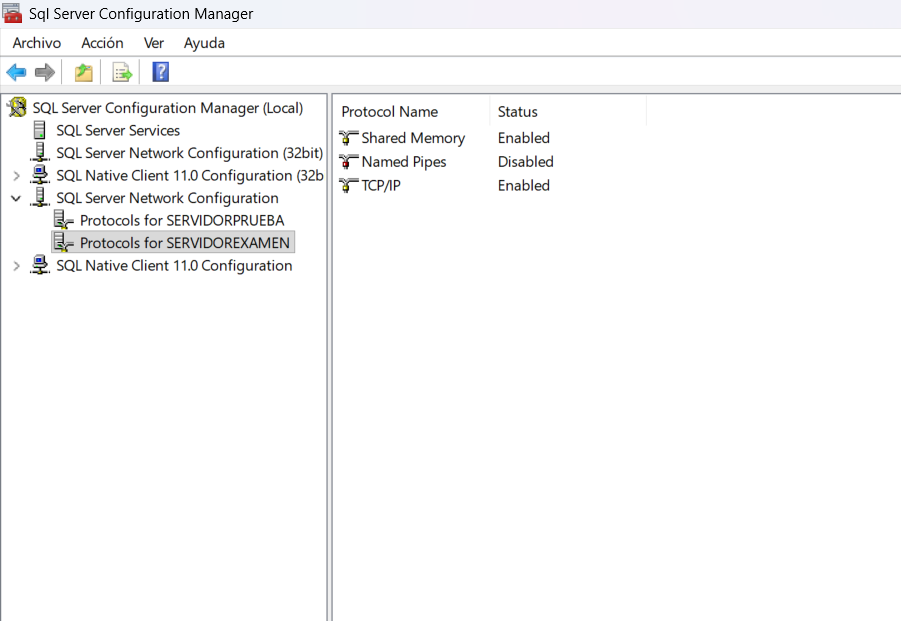

**02. Puerto TCP 1433**

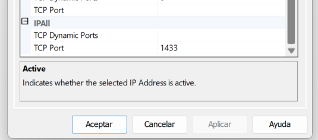

**03. Servicio SQL Server en ejecución**

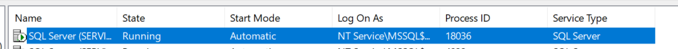

**04. Creación de la base de datos y sus tablas**

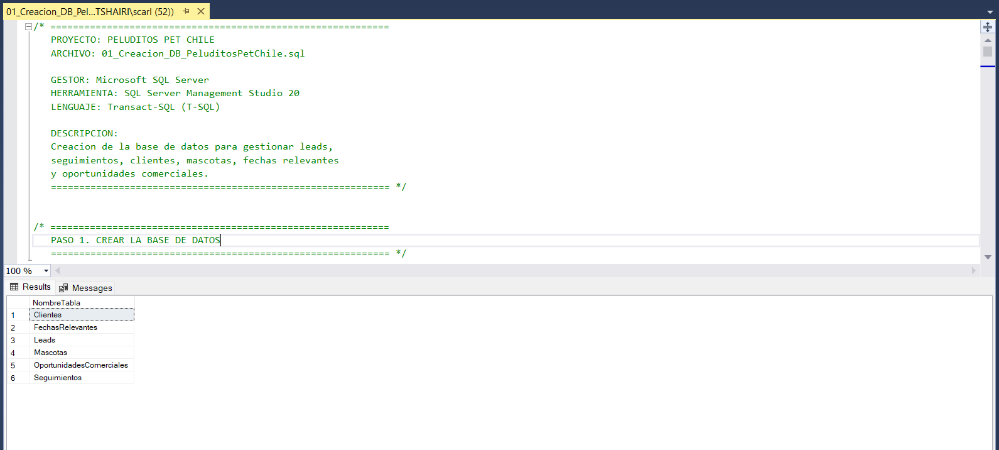

**05. Inserciones de prueba**

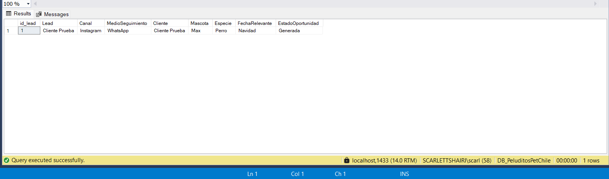

**06. Consultas de verificación**

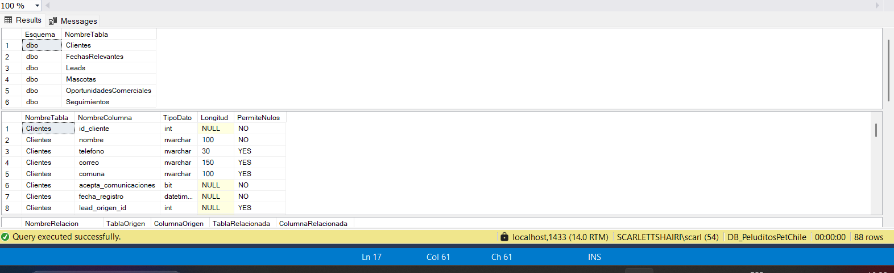

**07. Creación del usuario de aplicación para SQL Server** — contraseña ocultada por seguridad.

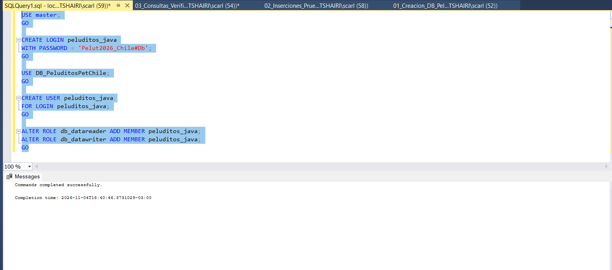

**08. Configuración de la variable de entorno del Web Service** — valor ocultado por seguridad.

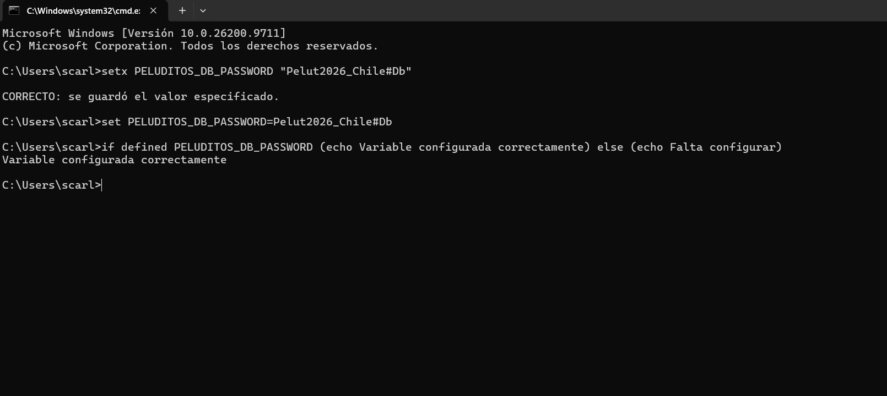

### B. Web Service, Flowable y Worker

**09. Inicio del Web Service**

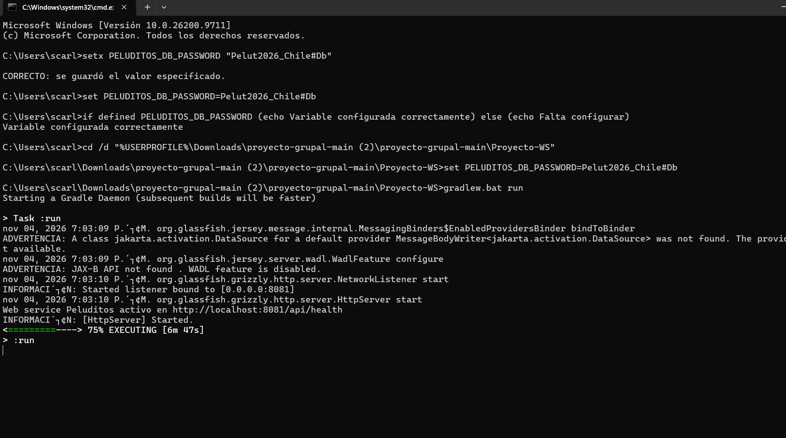

**10. Verificación del endpoint de salud del Web Service**

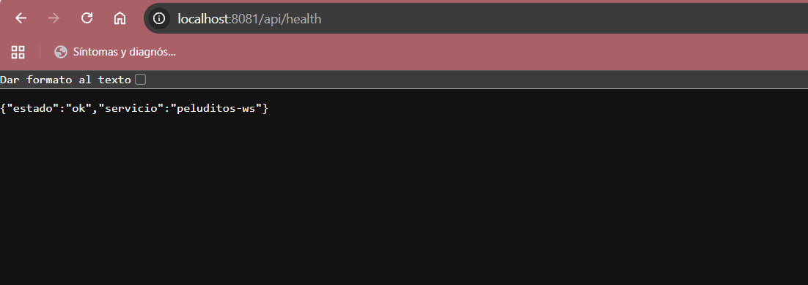

**11. Flowable OSS 7.2.0 en ejecución**

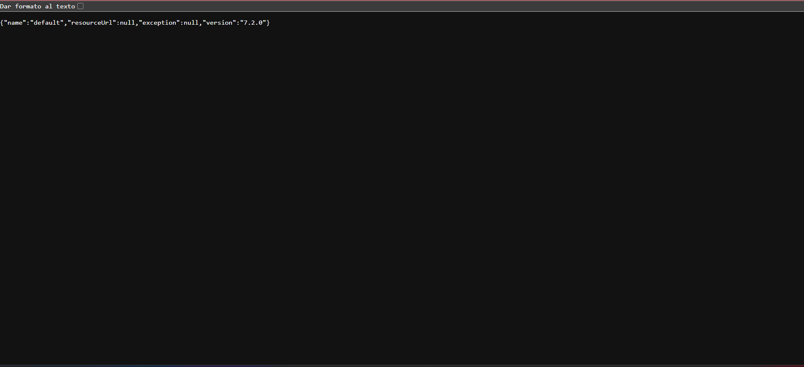

**12. Worker escuchando los dos topics**

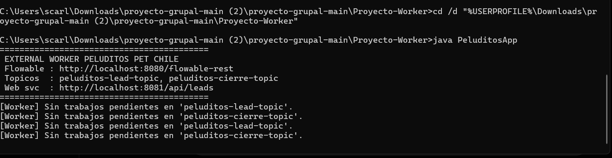

**13. Primera prueba de integración y registro del lead**

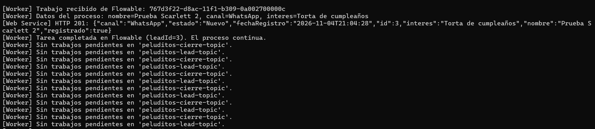

**14. Primera prueba de cierre de lead**

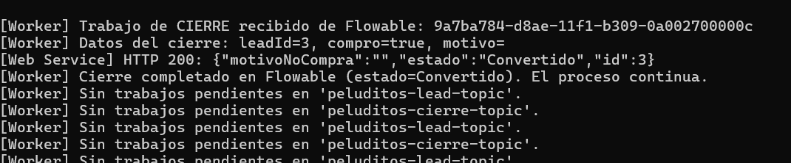

### C. PostgreSQL y validación final

**15. Flowable 7.2.0 responde después de configurar PostgreSQL**

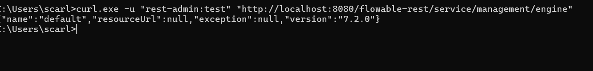

**16. Tablas internas de Flowable en `flowable_db`**

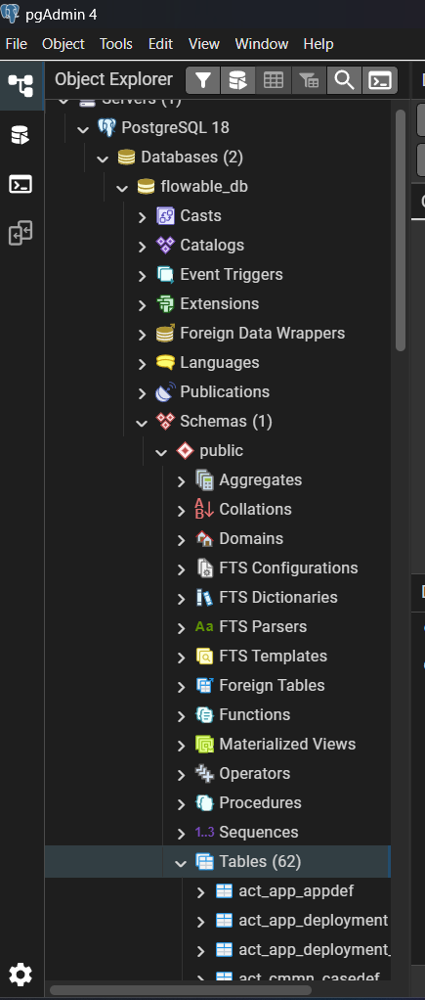

**17. Despliegue del BPMN en PostgreSQL (HTTP 201)**

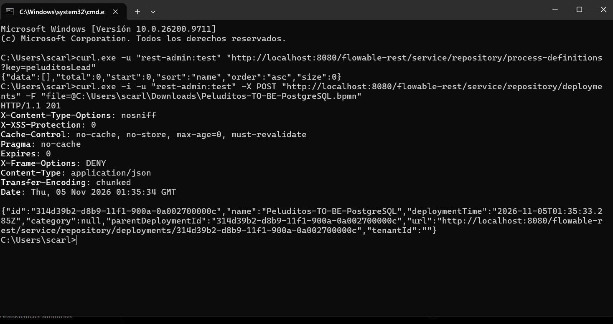

**18. Definición `peluditosLead` registrada en Flowable**

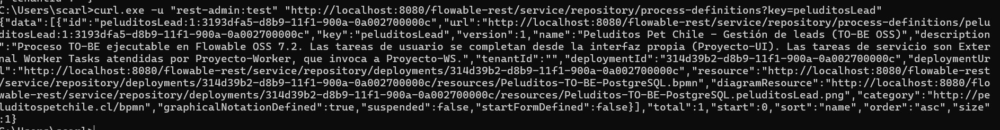

**19. Registro de lead después de conectar Flowable a PostgreSQL (HTTP 201)**

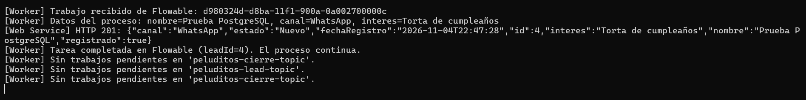

**20. Cierre del lead después de conectar Flowable a PostgreSQL (HTTP 200)**

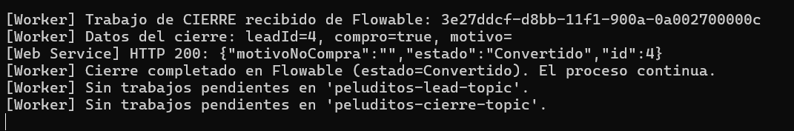

---

**Resultado:** se verificó el recorrido Flowable → External Worker → Web Service → SQL Server para el registro y cierre de leads, y la persistencia del motor Flowable en PostgreSQL.
